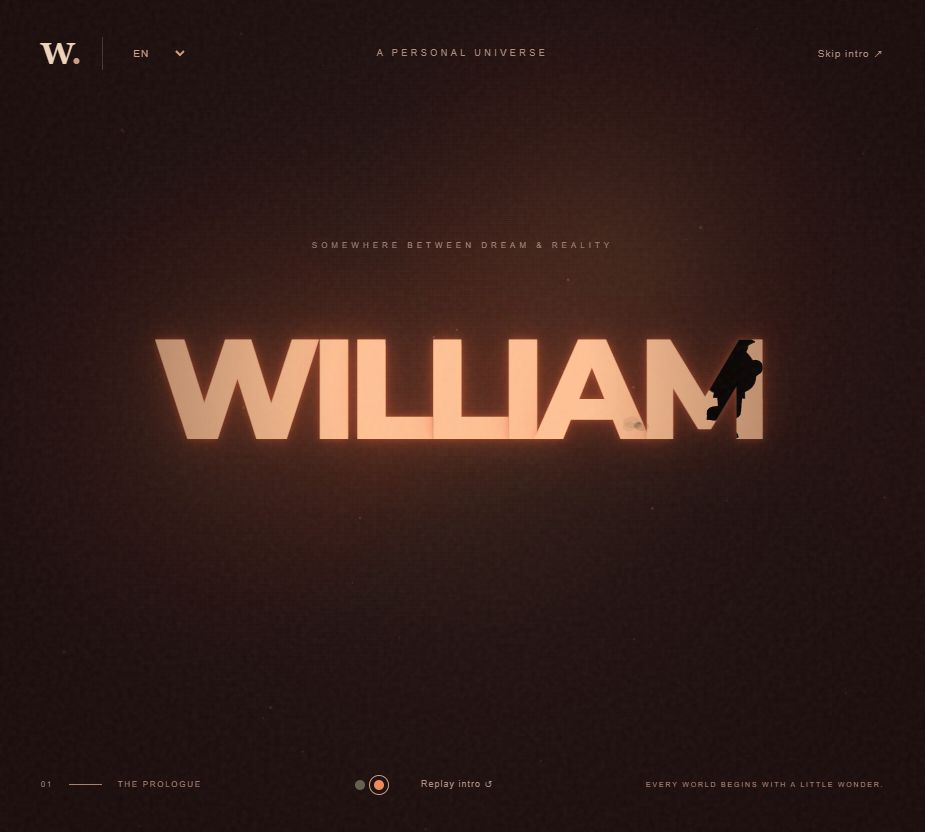

# WILLIAM · Personal Universe

WILLIAM 个人网站的开场序幕。名称暂定，设计与内容会持续迭代。

## 当前体验

- 暗色雾幕、胶片颗粒与微尘；保留青黄初始配色，可切换橙红配色。
- 标题从左到右逐字渐亮，然后整体闪烁。
- 冬装小胖子连续跑过，剪影与脚底扬尘只在标题字形内可见。
- 欢迎语渐显后点击进入过渡页，支持跳过与重播。
- 默认英文，支持中文与日语；保存当前浏览器的语言、配色选择。
- 适配移动端、键盘操作和减少动态效果偏好。

## 打开网站

无需安装依赖或构建，直接用浏览器打开 `dist/index.html`。

也可以在仓库目录启动本地服务器：

```sh
python -m http.server 4173 --directory dist --bind 127.0.0.1
```

然后访问 `http://127.0.0.1:4173/`。网络字体不可用时会回退到系统字体。

## 目录

```text
dist/
  index.html       页面与角色结构
  style.css        基础布局和氛围
  experience.css   配色、动画和多语言排版
  app.js           文案、交互、雾幕、跑步与字形遮罩
DESIGN.md          设计概念、规范和迭代记录
.openai/
  hosting.json    原 Sites 项目配置（不含凭证）
preview*.png       设计预览截图
```

完整设计说明见 [DESIGN.md](DESIGN.md)。当前正式内容页仍待设计，下一页是过渡占位。

## 验证

```sh
node --check dist/app.js
```

已进行浏览器交互和移动端排版检查。Git仓库用于保存源码；在线部署状态与仓库是否推送相互独立。


